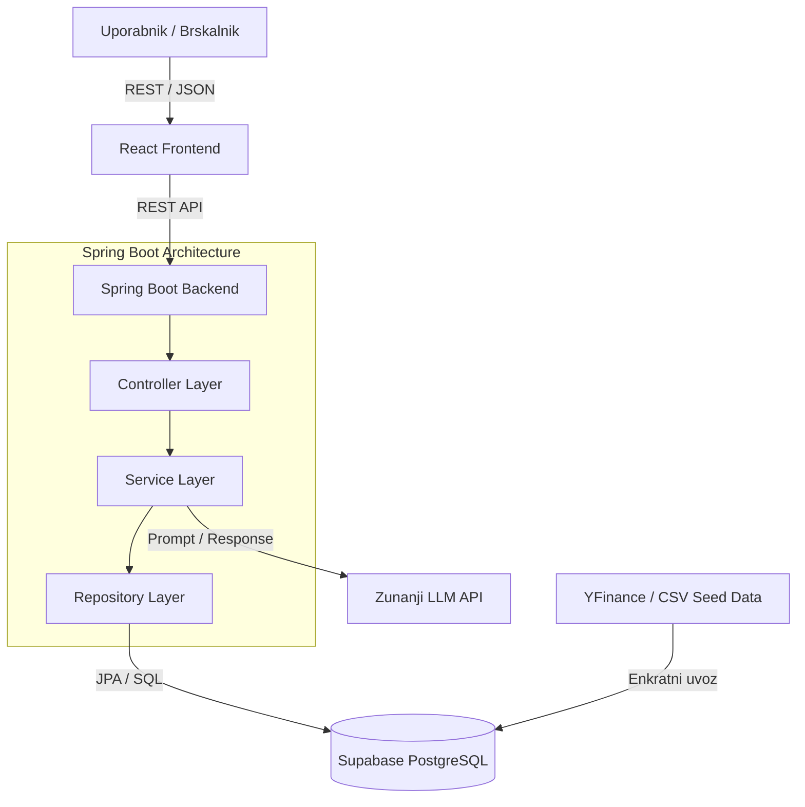

# 04 – Arhitektura in tehnološki sklad

## Arhitektura sistema

Sistem je zasnovan kot večslojna spletna aplikacija z ločenim sprednjim in zadnjim delom.

### Glavni deli sistema

1. **Frontend (React SPA):** Uporabniški vmesnik za konfiguracijo eksperimentov, prikaz grafov uspešnosti ter branje utemeljitev AI agentov.
2. **Backend (Spring Boot API):** Strežniška aplikacija z večslojno arhitekturo (_Controller -> Service -> Repository_), ki skrbi za pripravo anonimiziranih posnetkov, komunikacijo z LLM API-ji in preračun finančnih kazalnikov.
3. **Podatkovna baza (Supabase / PostgreSQL):** Hramba lokalno uvoženih tečajev delnic, agentov in izvedenih napovedi z utemeljitvami.

---

### Komunikacija med deli sistema

- **Frontend <-> Backend:** REST API preko HTTPS (JSON format).
- **Backend <-> LLM API:** REST kliki na zunanje API-je (npr. OpenAI) ali lokalne modele.
- **Backend <-> Baza podatkov:** Spring Data JPA / JDBC povezava do Supabase PostgreSQL baze.

---

### Podatkovna baza in uvoz podatkov

Uporabljena je relacijska baza **PostgreSQL** na platformi **Supabase**. Finančni podatki (tečaji in delnice) se iz zunanjih virov (npr. Yahoo Finance) **enkratno uvozijo in shranijo neposredno v bazo**. Aplikacija med delovanjem ne potrebuje zunanjih klicov za pridobivanje cenovnih serij.

---

### Upravljanje uporabnikov in avtentikacija

Sistem **nima registracije in prijave** (javno raziskovalno orodje). Vsi obiskovalci imajo takojšen dostop do vseh funkcionalnosti. Nastavitve in API ključi se upravljajo preko okoljskih spremenljivk (`.env`).

---

### Arhitekturni diagram (Mermaid)



# Tehnološki sklad

| Sklop               | Tehnologija / Orodje                      | Opis                                                 |
| ------------------- | ----------------------------------------- | ---------------------------------------------------- |
| **Frontend**        | React, TypeScript, Tailwind CSS, Recharts | Interaktivni grafi in pregleden uporabniški vmesnik. |
| **Backend**         | Java 21, Spring Boot, Spring Data JPA     | Večslojna struktura za poslovno logiko in API.       |
| **Podatkovna baza** | Supabase (PostgreSQL)                     | Relacijska baza za uvožene cene, agente in napovedi. |
| **Podatki**         | Yahoo Finance (YFinance API / CSV)        | Enkratni uvoz zgodovinskih tečajev v bazo.           |
| **Avtentikacija**   | _Brez (Javni dostop)_                     | Dostop brez sej in uporabniških računov.             |
| **Lokalni razvoj**  | Maven, Node.js / Vite                     | Enostaven lokalni zagon sprednjega in zadnjega dela. |

---

## Arhitekturne odločitve

1. **Spring Boot (Layered Architecture):** Ločitev Controller-Service-Repository omogoča čisto logiko in enostavno vzdrževanje.
2. **Lokalno shranjeni podatki v bazi:** Enkratni uvoz odpravi odvisnost od zunanjih finančnih API-jev med izvajanjem eksperimentov.
3. **Supabase (PostgreSQL):** Omogoča hitro relacijsko poizvedovanje po cenah ter shranjevanje portfeljev v `JSON` formatu.
4. **Brez avtentikacije:** Poenostavi sistem in omogoča takojšnjo uporabo.

---

## Način lokalnega zagona

### 1. Zagon ozadja (Backend)

```bash
cd backend
mvn clean install
mvn spring-boot:run
```

### 2. Zagon čelnega dela (Frontend)

```bash
cd frontend
npm install
npm run dev
```
