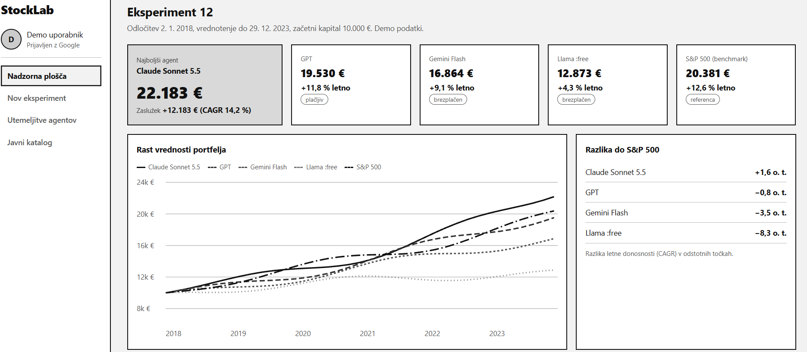
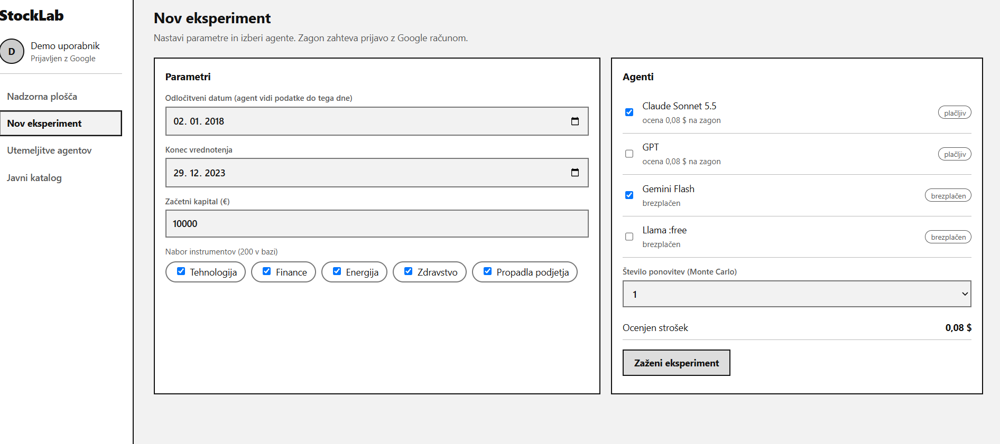
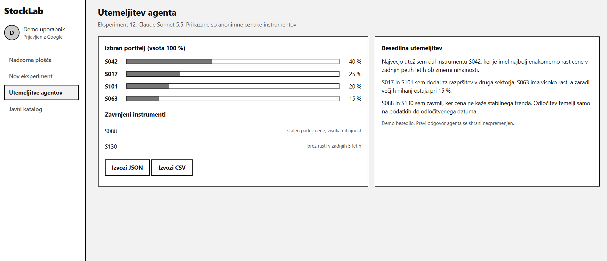

# 05 – Wireframes
 
Wireframe-i prikazujejo osnovni izgled aplikacije StockLab. Podatki na slikah so demo vrednosti.
 
## 1. Nadzorna plošča eksperimenta

 
Prikazuje rezultate enega eksperimenta: najboljšega agenta z zaslužkom, kartice ostalih agentov in benchmarka S&P 500, graf rasti vrednosti portfeljev, razliko do S&P 500 in lestvico uspešnosti (končna vrednost, zaslužek, CAGR, nihajnost, največji padec).
 
**Pokriva zgodbe:** US-07, US-08, US-09
 
## 2. Nov eksperiment
 

 
Obrazec za nastavitev odločitvenega datuma, konca vrednotenja, kapitala in nabora instrumentov ter izbiro agentov z oznako „plačljiv“ ali „brezplačen“. Ob izbiri se sproti izračuna ocenjen strošek, uporabnik pa izbere tudi število ponovitev (Monte Carlo).
 
**Pokriva zgodbe:** US-02, US-03, US-14 (zagon zahteva prijavo, US-01)
 
## 3. Utemeljitev agenta
 

 
Prikazuje portfelj, ki ga je izbral agent (uteži po anonimnih oznakah, vsota 100 %), zavrnjene instrumente z razlogom, besedilno utemeljitev in gumba za izvoz v JSON ali CSV.
 
**Pokriva zgodbe:** US-10, US-15